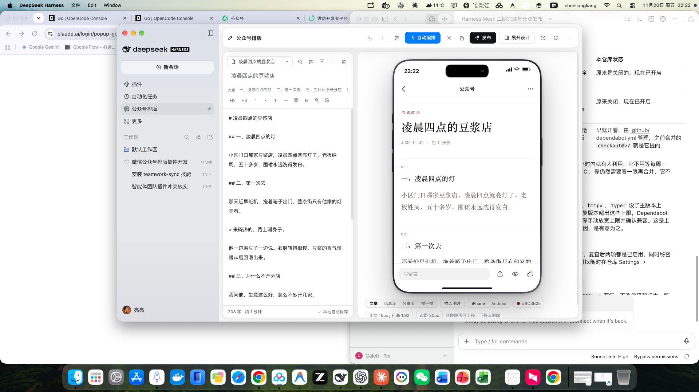
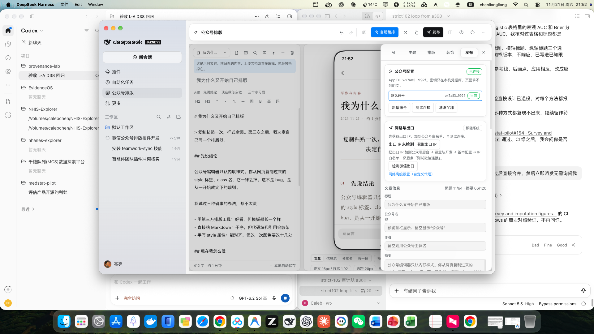
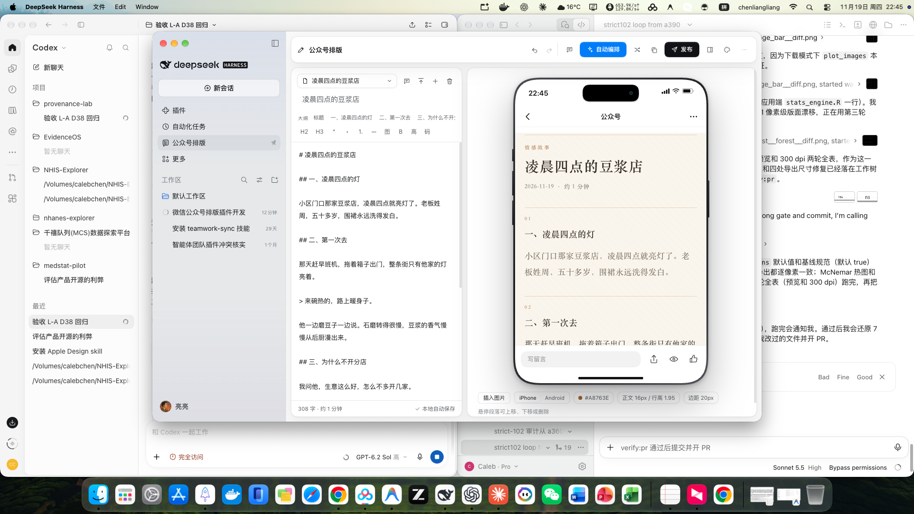
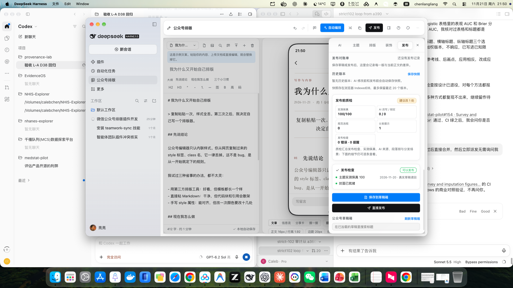
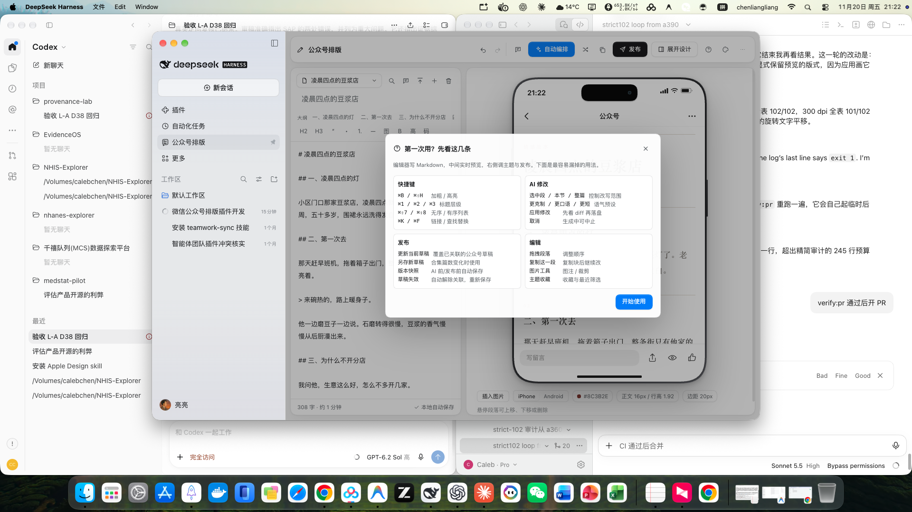

# 公众号排版工作台（WeChat article studio）

[](https://github.com/CalebChen941028/dsh-wechat-studio/actions/workflows/test.yml)
[](LICENSE)

DSH 侧边栏插件：把公众号文案写成 Markdown，通过 AI 对话直接生成版式，实时渲染成微信可粘贴的 HTML，改完直接复制或发布。

完整功能清单与审计边界见 [docs/FEATURES.md](docs/FEATURES.md)。

## 打开方式

左侧图标栏多出一个「公众号排版」图标，点开就是工作台：左边写文案，中间实时预览手机版式，右边微调 AI 生成的配色、字号、装饰和发布。

## 能做什么

- **粘贴/上传即排版**：把文案粘进编辑区，或直接上传 `.md` / `.txt` / `.docx` / `.html`（支持拖进左栏）。内容落下先给一版中性纸感底版（不联网、立即出画面）；真正的版式设计在 AI 对话里完成，不会有自动选主题或静默覆盖。
- **外观切换**：顶栏「调色板」里可以切 跟随应用 / 浅色玻璃 / 深色玻璃 / 暖砂 四套界面，以及六种强调色；界面走中性玻璃质感，不用彩色光晕和大面积渐变，避免抢正文的注意力。
- **实时渲染**：编辑区每条改动即时反映到中间的 iPhone 18 Pro 预览框，里面有灵动岛、状态栏、公众号原生顶栏（返回 / 公众号名 / 更多）、留言 / 分享 / 在看 / 赞底栏和 Home 指示条，预览底部可切换 iPhone / Android 两种机身；输出只含内联样式，符合公众号编辑器「丢 style、丢 class」的限制。
- **AI 对话设计**：打开 AI 页直接说「按这篇的气质设计版式」「做成画册感，多留白」「标题更有冲击力」。模型返回一套完整 custom 设计 token（配色、字体、字号、留白、底纹、角标、标题/小节/引文/配图组合），纯版式修改直接生效并可撤销；同时改正文时才先出 diff 等确认。系统没有主题库，不需要先选模板。
- **AI 对话修改**：点左栏的对话图标或顶部「AI 修改」打开「AI」页，直接说人话，例如「标题更有冲击力」「第二段压到两行」「换成暖色」「行距调到 1.9」。模型按当前默认模型调用，只返回结构化修改（完整正文 / custom 设计 token / 标题摘要），改完可以一键撤销；生成过程用 SSE 推送进度，不再干等。数据只在 Host 与模型服务之间传输，不经过第三方。
- **大纲与段落联动**：编辑区顶部出现标题大纲，点击可定位编辑器和预览；在编辑器里移动光标，预览会同步高亮对应段落。
- **图片图注**：悬停图片点「编辑图注」即可单独改图片说明，不碰图片地址，留空则不显示图注。
- **长文渲染**：预览用 `useDeferredValue` 延迟追平输入，长文打字时编辑器先响应。
- **发布前质检**：把发布检查、AI 来源、段落锁与分发警告汇成一张「先别发 / 建议改 N 处 / 可以发」的结论卡。
- **编辑部规范**：每篇文档可保存语气、禁用词、偏好词、段落上限和图片图注要求；AI 修改和发布检查都会读取。
- **片段库**：作者简介、关注引导、免责声明等常用块，支持 `{{title}}`、`{{author}}`、`{{date}}`、`{{brand}}` 变量；⌘K 命令面板可直接调用。
- **诊断与错误边界**：渲染出错时显示恢复页；诊断报告可看存储用量、最近 20 条运行时错误并复制报告。
- **品牌包**：版式 DNA、写作规范和片段一起导出/导入。
- **发布复盘**：读取近 7 天图文数据（阅读、分享），公众号没有数据权限时只保留发布对账单。
- **多账号工作区**：支持新增、切换、删除公众号账号，每个账号独立密钥，页面不显示 Secret，旧单账号记录会自动迁移。
- **AI 风格记忆**：记录 AI 建议被采用/放弃的情况，下一次修改会把最近采用的改法一起带给模型。
- **图片素材库**：已上传图片跨文章复用，支持上传、插入和删除。
- **发布计划**：给草稿设置本地计划日期，发布面板列出近期排期；只提醒，不会自动发布。
- **长文与无障碍**：内容块启用渲染跳过与图片懒加载，支持减少动效适配与键盘焦点环；长文解析/渲染有性能预算测试。
- **排版体检**：自动统计长段落、半角标点、多余空行、高亮数量、缺图注和标题跳级，可一键拆分/统一标点/整理空行。
- **AI 修改预览**：AI 改完先展示增删行与版式变化，点「应用修改」才写入，也可直接放弃；正文期间被手动改动时不会覆盖新内容。
- **覆盖更新草稿**：保存过的草稿会记住 media_id，之后可「更新当前草稿」或「另存新草稿」；多图文篇数不变也能逐篇覆盖，草稿失效会自动解除关联并提示重新保存。
- **AI 选区改写**：选中某段后只让 AI 改这一段，diff 也只显示该段变化；支持「选中段 / 本节 / 整篇」和「更克制 / 更口语 / 更短」语气预设，发送前显示大概 token 数，生成中可取消。
- **编辑快捷键**：⌘B 加粗、⌘⇧H 高亮、⌘1/2/3 标题、⌘⇧7/8 列表、⌘K 链接、⌘F 查找替换；工具条会显示当前格式。
- **版本快照**：AI 应用前、发布前自动快照，也可手动保存；最近 20 个版本可看 diff 后再恢复。
- **使用提示**：顶栏「?」打开快捷键和隐藏功能清单；首次打开自动显示三条上手提示。
- **跨窗口提醒**：两个窗口同时改同一草稿时，后保存的一侧会出现「另一窗口更新了草稿」提示，由你决定载入还是继续用当前版本。
- **草稿箱分页与搜索**：最近草稿支持上一页/下一页和当前页标题搜索，不再只读 10 篇。
- **封面布局**：封面支持左对齐、居中、底部、极简四种版式。
- **块操作**：预览里可拖拽排序、复制段落，悬停仍可上移、下移、删除。
- **图片裁剪**：图片工具支持 1:1 / 4:3 / 16:9 居中裁剪；远程图片会先由 Host 取回再裁。
- **分发镜**：预览可在「文章 / 信息流 / 分享卡 / 搜一搜」四种场景切换，按微信真实比例显示标题截断、摘要截断和封面安全区域，并在下方列出会发生的裁切警告。
- **发布对账单**：每次保存、更新、发布都会记一条账本，包含版式名、篇数、media_id 尾号、内容 hash；顶部显示当前正文与最近一条记录的增删行数，点击可看 diff 或恢复。
- **版式 DNA**：上传一张喜欢的文章截图，提取纸色、强调色和明暗，生成三个配方，可套用或存成「我的版式」。
- **段落锁与 AI 来源**：预览里可锁定段落，AI 选区会自动跳过；AI 改写过的段落左侧有细标记，选中时显示来源。
- **排版预设**：字号与节奏页提供「紧凑 / 标准 / 舒展 / 杂志」四档，按当前版式比例一键调整字号、行高、段距和留白，再继续微调。
- **富文本粘贴**：从网页或公众号编辑器复制内容直接粘贴，会优先按 HTML 结构转成 Markdown，保留标题、列表、引用、加粗和图片。
- **发布检查**：保存或发布前自动检查标题/摘要长度、封面、图片体积、外链和 HTML 体积，问题集中列出。
- **长文分段改写**：文章超过 7,000 字时，AI 页会出现「长文分段改写」开关；打开后按小节拆成多段分别调用模型改写正文，最多 8 段，版式保持不变。
- **插图**：编辑区工具栏「图」、直接粘贴截图、拖入图片文件，或点预览下方「插入图片」都能把图片放进正文；上传 .docx 时会自动提取文档里的内嵌图片，过大的图会先压缩再转成 Markdown 图片。图片数据存在 IndexedDB，正文只保留 `wsimg://` 短引用，不再把 base64 塞进编辑区和本地存储；导出 Markdown / JSON 时会自动展开成 data URL。
- **带图发布**：保存草稿或直接发布前，正文里的图片会先压缩并上传到微信 CDN、外链图片自动转存，再写入草稿；封面单独上传为永久素材。单张正文图片控制在 1MB 以内（代码里按 900KB 留余量）。图片可以调宽度（通栏 / 大图 / 中等 / 小图）和对齐，悬停图片可点工具条换图。
- **AI 按内容设计**：模型先读内容主题、结构、篇幅和标题长度，再直接原创一套版式（配色、字体、字号、留白、底纹、角标与标题/小节/引文/配图组合）。没有主题库，也没有预设模板；每次说明设计判断，不会顺带重写正文。
- **背景与角标**：装饰面板可换背景色（跟随当前版式 / 纸白 / 米色 / 冷灰 / 墨黑）、底纹（纸纹 / 网格 / 点阵 / 竖线 / 淡彩）和矢量角标（边角线 / 栏线 / 印记 / 叶形 / 枝叶 / 星标）；深色背景会自动换成浅色文字。
- **交互调整**：主色、标题/章节/引用/分割线/列表/图片样式、字号、行高、字间距、段间距、左右留白、导语、话题标签、文末引导都可改；预览里可以拖拽段落、复制段落，鼠标移到段落上也能上移、下移、删除。
- **草稿**：本地自动保存多份草稿，支持导入 `.md` / `.txt` / `.json`，导出 HTML / Markdown / 草稿 JSON。
- **复制**：一键把带内联样式的 HTML 写进剪贴板，粘到公众号编辑器即可保留版式。
- **发布**：填 AppID 与 AppSecret 后可以保存到公众号草稿箱、覆盖更新已关联的草稿，或直接提交发布并回查状态。正文里的本地图片和微信外链图片会先转存到微信 CDN，封面按当前版式自动生成（也可上传自己的图）。发布选项里可以开关评论、限制仅关注者可评；勾选其他本地草稿可以一次保存成多图文草稿（最多 8 篇）。
- **草稿箱**：发布面板支持分页浏览与标题搜索公众号草稿，可直接删除或「导入」回工作台继续编辑（多图文草稿会逐篇导入）。
- **多图文合集**：发布面板可以把其他本地草稿勾进「合集」，一次写入 1–8 篇文章；每篇单独上传图片和封面，发布仍是一个整体操作。

## 密钥与权限

- AppSecret 只写进本机 DSH 凭据库（credentials 记录 `wechat-studio/account`），保存后页面只能看到 AppID 前缀，拿不到明文。
- 调用微信接口需要把本机出口 IP 加进公众号后台「设置与开发 → 基本配置 → IP白名单」，否则会返回 40164。
- 发布接口要求公众号已认证；未认证账号通常只能用「保存到草稿箱」或「复制 HTML」。

## 给 Agent 用的工具

插件注册了三个工具，Agent 不打开面板也能跑完整条链路：

- `wechat_studio_status`：检查是否已保存 AppID/AppSecret；`testConnection: true` 时还会取一次 access_token，验证密钥与 IP 白名单。
- `wechat_studio_ai_edit`：按自然语言改文案或换版式，返回改后的完整 Markdown 与 custom 设计 token，不涉及发布。
- `wechat_studio_save_draft`：用面板同一套渲染器把 Markdown 排成内联样式，自动把图片转存到微信 CDN、上传封面，写进公众号草稿箱；`publish: true` 时再提交发布。面板里的「AI」页和这个工具走同一段 Host 代码，行为一致。

## 安全

- 密钥只存在本机 DSH 凭据库，页面只能看到 AppID 前缀。
- HTTP 路由只接受 POST，要求 `x-wechat-studio: 1`，并校验 `Origin` / `Host` / `Sec-Fetch-Site`，拒绝跨站请求。
- 转存外链图片时会拒绝本机、内网、链路本地和云元数据地址，并校验重定向后的最终地址。
- 草稿正文保存在浏览器 IndexedDB，localStorage 只留界面偏好和当前草稿 id，长文和大量草稿不再挤占 5MB 配额；IndexedDB 不可用时自动回退 localStorage。写入失败会提示，避免静默丢稿；自动生成的封面不落库，需要时按版式重算。
- 正文图片存在 IndexedDB，删除草稿后会清理没有被任何草稿引用的图片。

## 本地 HTTP 接口

Host 半部注册一条同源路由 `POST /wechat-studio/api`，供页面调用微信接口。它只接受 POST JSON，要求自定义请求头 `x-wechat-studio: 1`，并拒绝跨站 `Origin` / `Sec-Fetch-Site` 请求；请求体上限 32 MiB。

## 安装

这是一个 DSH bundle：把本目录安装进 DSH 的 profile 即可，`package.json` 里的 `dsh.bundle.patch` 会把它挂到侧边栏。`client.js` 已随仓库提交，不需要先构建。

## 真实发布回归（仅测试公众号）

```bash
WX_APPID=... WX_SECRET=... WX_COVER_PATH=/path/cover.png WX_ALLOW_PUBLISH=1 npm run e2e:publish
```

会建一篇临时草稿、提交 `freepublish/submit`、轮询状态、读取 `article_id` 后删除刚发布的文章。**这会真实通知关注者**，只应在测试公众号上运行；默认不带 `WX_ALLOW_PUBLISH=1` 会直接拒绝执行。

## 功能截图

### 分发镜与正文预览



### 多账号与账号迁移



### 大纲与段落联动



### 发布质检与对账单



### 首次使用提示



## 开发

```
npm ci                    # 安装测试与构建依赖（jsdom、fake-indexeddb、react、@napi-rs/canvas 等）
npm run build             # src/*.mjs -> client.js
npm run build:check       # 校验已提交的 client.js 与 src/*.mjs 是否同步
npm test                  # 解析、编排、渲染、Host 服务、AI、图片注册表、docx 解析测试
```

打 `v*` tag 会触发 `.github/workflows/release.yml`：跑测试、打源码包、创建 GitHub Release。

`client.js` 是构建产物，不要手改。浏览器侧源码按块拆在 `src/ui-shell.mjs`、`ui-editor.mjs`、`ui-design.mjs`、`ui-misc.mjs`，`build.mjs` 按顺序拼接；改完跑 `npm test` 和 `npm run build`。

## 已知限制

- 真实发布需要你自己的公众号凭据与 IP 白名单，仓库内的测试只覆盖错误路径与请求形状，没有连真实公众号跑过端到端发布。
- 超过约 7,000 字的文章，默认只允许改版式，不替换正文，避免长文被截断；输出 token 预算会随正文字数上调，上限 8,192。要改长文正文，打开「长文分段改写」，或手动拆成几篇。
- 正文图片来自本地粘贴/上传、预览里的「插入图片」、外链，或上传 `.docx` 时自动提取；超过 240KB 的文档内嵌图会先压缩再写入正文。
- 微信对草稿正文、标题（64 字）、作者（8 字）、摘要（120 字）有限制；超长会截断并在发布面板提示。
- 复杂排版（表格、嵌套列表、公式）暂不支持，会按普通段落渲染；Word 表格会转成「单元格 ｜ 单元格」的普通行。
- `.docx` 解析在浏览器里完成：正文、标题层级和常用内嵌图片会带过来；页眉页脚、批注、文本框里的图不处理。PDF 与旧版 `.doc` 不支持。

## 许可

MIT，见 [LICENSE](LICENSE)。
