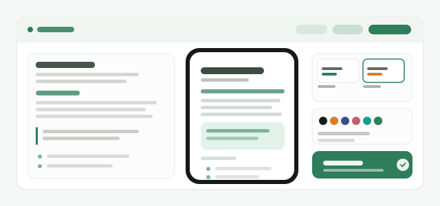

# 公众号排版工作台 · 详情

## 是什么

DeepSeek Harness（DSH）的侧边栏 bundle：把 Markdown 变成公众号文章，提供实时手机预览、按内容选主题、图片处理、AI 改稿/改版式，以及草稿发布。

## 结构

- `index.js`：Host 入口，注册 `POST /wechat-studio/api`、`/wechat-studio` 精确路由和 Agent 工具（状态检查、AI 编辑、保存草稿等）。
- `host/`：Node 侧代码。`wechat.js` 封装微信接口（token、stable_token、图片上传、草稿增删查、发布）；`service.js` 是动作层，处理凭据、token 缓存、图片转存、草稿与发布；`http.js` 做请求体限制与同源校验；`ai.js` 负责模型调用、提示词、JSON 校验和覆盖参数清洗。
- `src/`：浏览器侧代码，由 `build.mjs` 拼成 `client.js`。`engine.mjs` 解析 Markdown、识别主题、排序主题并合成设计；`themes.mjs` 是 13 套主题 × 2 个版式；`render.mjs` 生成一棵节点树，同时投影成 React 预览和内联样式 HTML；`docparse.mjs` 解析 `.docx`/`.html` 并提取内嵌图片；`bridge.mjs` 负责 Host 调用、剪贴板和图片压缩；`i18n.mjs` 负责界面文案，源文案保持中文、`t()` 查英文词表，语言依次取显式设置、DSH locale、页面 `lang`；`images.mjs` 是图片注册表：正文保留 `wsimg://id` 短引用，图片数据存 IndexedDB，解析、渲染和发布前再把引用展开成 data URL；`ui.mjs` 是三栏面板、编辑器、预览、设计控件、发布面板与 AI 对话。

## 数据流

1. 编辑区文本在本地解析，`composeDesign` 把主题、版式和覆盖参数解析成具体样式。
2. 同一棵节点树同时供实时预览和复制/发布 HTML 使用，避免两边不一致。
3. 发布时：data URL 图片先压缩并上传到微信 CDN，外链图片自动转存，然后创建草稿，按需提交发布。
4. AI 编辑返回结构化 JSON（`reply`、可选 `text`、`design`、`meta`），客户端应用文本或版式修改，并支持撤销。对话面板走 `aiEditStream` 的 SSE 变体显示生成进度；长文可以打开分段改写，按小节分别调用模型。
5. 插入图片时先写注册表，正文只留引用；解析、渲染、发布前展开成 data URL；导出会展开引用，删除草稿后清理无引用的图片。

## 安全

- 密钥只存在 DSH 凭据库，页面只能看到 AppID 前缀。
- HTTP 路由要求自定义请求头，并校验 `Origin` / `Host` / `Sec-Fetch-Site`，拒绝跨站请求。
- 转存外链图片时拒绝本机、内网、链路本地与云元数据地址，重定向后的最终地址也要通过校验。
- 本地存储写满会提示；自动生成的封面不写入 localStorage。

## 限制

- 微信草稿/发布接口需要认证公众号与 IP 白名单；一篇草稿最多 8 篇文章。
- 单张正文图片上限 1MB（代码会重新编码到约 900KB）。
- 超过约 7,000 字的文章只做版式修改。
- 不支持表格、嵌套列表、公式；Word 正文之外的图片会跳过。
- 预览是 iPhone 形状的近似，不是微信真机像素级还原。
